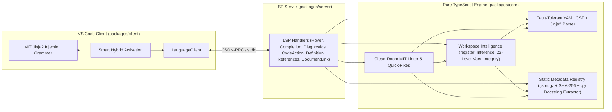

# Ansible Lens

**Zero-dependency, cross-platform, static-metadata Ansible Language Server & VS Code Extension.**

Ansible Lens delivers sub-20ms IntelliSense, Pylance-style hover documentation, cross-file variable precedence resolution, `register:` return-value type inference, project integrity diagnostics, and 1-click Quick-Fix linting in pure TypeScript—with **zero Python**, **zero WSL**, and **zero Docker** required at runtime.

> _Ansible Lens is an independent, community-built extension and is not affiliated with or endorsed by Red Hat, Inc. Ansible® is a registered trademark of Red Hat, Inc._

---

## Key Features

- **Zero Python / WSL / Docker Runtime Dependencies:** Runs natively on Windows, macOS, and Linux in pure Node.js/TypeScript. Never invokes `ansible-playbook`, `ansible-lint`, or external Python subprocesses while you edit.
- **Sub-20ms Fault-Tolerant Parsing & Linting:** Powered by a Concrete Syntax Tree (CST) YAML parser (`yaml` with `keepSourceTokens: true`) paired with a fault-tolerant Jinja2 lexical scanner (`{{ ... }}`, ``, `{# ... #}`, and implicit conditionals in `when:`, `changed_when:`, `failed_when:`, `until:`). Half-typed playbooks and unclosed Jinja braces never crash the Language Server.
- **Pylance-Style Hover Tooltips:** Rich Markdown hover cards showing module summaries, parameter types, defaults, valid `choices`, `version_added`, deprecation warnings, and direct deep links to `https://docs.ansible.com/...`.
- **`register:` Return-Value Type Inference (`loop:`-Aware):** Tracks `register: my_result` bindings, resolves module `RETURN` schemas plus common task fields (`failed`, `changed`, `skipped`, `rc`, `stdout`, `stdout_lines`, `stderr`, `stderr_lines`, `msg`), and automatically wraps schemas under `my_result.results[].<field>` and `item` when `loop:` or `with_*:` is present.
- **22-Level Cross-File Variable Precedence Graph:** Indexes variables across role `defaults/main.yml`, `vars/main.yml`, `group_vars/`, `host_vars/`, inventory files, play `vars:`, `vars_files:`, block/task `vars:`, `set_fact`, and `register:`, surfacing the winning definition, precedence rank (1–22), and shadowed definitions on hover and Go-to-Definition.
- **Workspace Project Integrity Checker:** Validates role references, `roles/<name>/tasks/main.yml` presence, `notify:` handler targets, `copy`/`template` `src:` files, and `hosts:` entries against workspace inventories.
- **Smart Hybrid Activation (`redhat.vscode-yaml` Coexistence):** Dynamically activates on Ansible files (`ansible.cfg`, `roles/**`, `tasks/`, `handlers/`, `group_vars/`, `host_vars/`, `playbooks/`, `site.yml`, or playbook structure) while explicitly ignoring Kubernetes manifests (`apiVersion:` + `kind:`), Docker Compose (`services:`), and GitHub Actions workflows (`on:` + `jobs:`). Injects lightweight MIT Jinja2 syntax highlighting into `source.yaml`.
- **Bundled + Lazy-Cached Collection Metadata Packs:** Bundles `ansible.builtin.json.gz` out of the box and lazy-downloads Top 10 Ansible Galaxy collection packs (`ansible.posix`, `community.general`, `community.docker`, `community.crypto`, `ansible.windows`, `amazon.aws`, `kubernetes.core`, `community.mysql`, `community.postgresql`, `ansible.utils`) with SHA-256 verification against `manifest.json`, plus static `.py` docstring extraction for local `library/` and `collections/` modules.

---

## Architecture

Ansible Lens enforces strict unidirectional dependencies (`packages/client` -> `packages/server` -> `packages/core`), keeping all parsing, metadata resolution, workspace intelligence, and linting 100% pure TypeScript with zero `vscode` imports in `packages/core`:



See [ARCHITECTURE.md](./ARCHITECTURE.md) and the [Architecture Decision Records](./docs/adr/) for full design details.

---

## Clean-Room Lint Rules & Quick-Fixes

All lint rules are implemented clean-room in pure TypeScript under the **MIT License** (zero GPL code):

| Rule ID                     | Severity  | Description                                                                                                                         | Quick-Fix Available                                     |
| --------------------------- | --------- | ----------------------------------------------------------------------------------------------------------------------------------- | ------------------------------------------------------- |
| `yaml-syntax`               | `error`   | Reports non-fatal YAML/Jinja2 syntax issues without halting analysis                                                                | —                                                       |
| `unknown-module`            | `error`   | Flags unknown modules not found in loaded metadata packs or workspace `library/`                                                    | Yes ("Did you mean `<fqcn>`?" via Levenshtein distance) |
| `unknown-param`             | `error`   | Flags unrecognized module parameters                                                                                                | Yes (suggests closest parameter name / alias)           |
| `missing-required-param`    | `error`   | Detects missing required module options                                                                                             | Yes (inserts missing parameter stub)                    |
| `invalid-choice`            | `error`   | Validates parameter values against allowed `choices`                                                                                | Yes (offers valid choice replacements)                  |
| `param-type-mismatch`       | `warning` | Checks static value types against module option types (`bool`, `int`, `list`, `dict`, `str`)                                        | —                                                       |
| `fqcn`                      | `warning` | Encourages Fully Qualified Collection Names (e.g. `ansible.builtin.copy` instead of `copy`)                                         | Yes (1-click expand short name to FQCN)                 |
| `name-missing`              | `warning` | Flags tasks or plays missing a descriptive `name:` field                                                                            | Yes (inserts `name: TODO` placeholder)                  |
| `no-changed-when`           | `warning` | Flags `command`/`shell` tasks missing `changed_when:` idempotency declaration                                                       | Yes (inserts `changed_when: false`)                     |
| `command-instead-of-module` | `warning` | Advises using dedicated Ansible modules (`apt`, `dnf`, `git`, `curl`/`get_url`, `systemctl`/`service`) instead of `command`/`shell` | —                                                       |
| `package-latest`            | `warning` | Warns against `state: latest` in package tasks for reproducible deployments                                                         | Yes (replaces `latest` with `present`)                  |
| `risky-file-permissions`    | `warning` | Flags file/copy/template tasks missing explicit `mode:` or using overly permissive modes (`0777`, `777`, `0666`)                    | Yes (inserts safe `mode: '0644'` / `'0755'`)            |
| `deprecated-module`         | `warning` | Surfaces deprecation timeline and replacement module from static metadata                                                           | Yes (replaces with `alternative` FQCN when available)   |
| `hardcoded-secret`          | `warning` | Detects plaintext secret-like keys (`password`, `token`, `api_key`, `secret`, `private_key`) without Jinja/vault                    | Yes (adds `no_log: true` or `!vault` guidance)          |
| `yaml-truthy`               | `warning` | Flags YAML 1.1 legacy truthy literals (`yes`, `no`, `on`, `off`, `TRUE`, `FALSE`)                                                   | Yes (normalizes to `true` / `false`)                    |
| `duplicate-keys`            | `error`   | Detects duplicate keys inside YAML mappings via CST inspection                                                                      | —                                                       |
| `missing-role`              | `error`   | Verifies referenced roles exist in workspace `roles/` or collection paths                                                           | —                                                       |
| `missing-role-tasks`        | `error`   | Checks that referenced roles contain `tasks/main.yml`                                                                               | —                                                       |
| `missing-handler`           | `error`   | Verifies `notify:` targets match defined handlers in plays or roles                                                                 | —                                                       |
| `missing-src-file`          | `warning` | Verifies `copy`/`template` `src:` paths resolve in workspace files/templates                                                        | —                                                       |
| `unknown-inventory-host`    | `warning` | Validates play `hosts:` patterns against parsed workspace inventory groups/hosts                                                    | —                                                       |

---

## Installation & Usage

### Installing from GitHub Releases

1. Download the latest `ansible-lens-<version>.vsix` and `SHA256SUMS.txt` from [GitHub Releases](https://github.com/amr-vibe/ansible-lens/releases).
2. Verify the download checksum:

   ```bash
   sha256sum -c SHA256SUMS.txt
   ```

3. Install in VS Code:

   ```bash
   code --install-extension ansible-lens-<version>.vsix
   ```

### Extension Commands

Open the VS Code Command Palette (`Ctrl+Shift+P` / `Cmd+Shift+P`):

- `Ansible Lens: Refresh Workspace Index` — Re-indexes playbooks, roles, inventories, variables, and local Python module docstrings.
- `Ansible Lens: Download / Update Collection Metadata Packs` — Fetches or verifies cached `.json.gz` Galaxy collection packs against `manifest.json`.
- `Ansible Lens: Show Output Log` — Opens the structured `Ansible Lens` OutputChannel for diagnostics and latency telemetry.

---

## Development & Testing

### Prerequisites

- **Node.js** `>= 20` (CI targets Node.js `22`)
- **npm** `>= 10`

### Local Setup & Verification

```bash
git clone https://github.com/amr-vibe/ansible-lens.git
cd ansible-lens
npm ci

# Build all workspace packages
npm run build

# Strict TypeScript type-checking
npm run typecheck

# Flat ESLint (--max-warnings=0)
npm run lint

# Prettier formatting check
npm run format:check

# Unit, fuzz, <20ms performance benchmark, and LSP integration tests with V8 coverage
npm test

# Package the VS Code extension (.vsix)
npm run package:vsix
```

### Rebuilding Static Metadata Packs (Linux / CI)

To regenerate `.json.gz` collection packs and SHA-256 `manifest.json` using `ansible-doc --metadata-dump`:

```bash
pip install ansible-core
npm run build --workspace=packages/core
npm run build --workspace=scripts/metadata-builder
node scripts/metadata-builder/dist/index.js --out-dir dist-metadata
```

---

## License & Governance

- Licensed under the [MIT License](./LICENSE).
- Third-party attributions are documented in [THIRD_PARTY_NOTICES.md](./THIRD_PARTY_NOTICES.md).
- Read [CONTRIBUTING.md](./CONTRIBUTING.md), [CODE_OF_CONDUCT.md](./CODE_OF_CONDUCT.md), and [SECURITY.md](./SECURITY.md) before opening a pull request.
