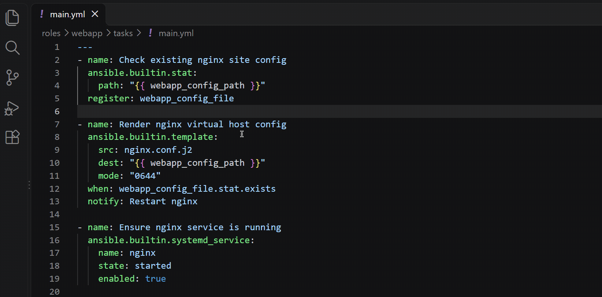
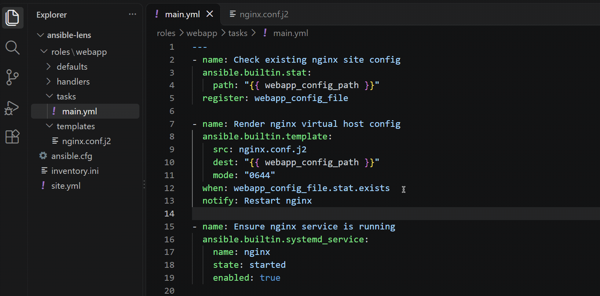
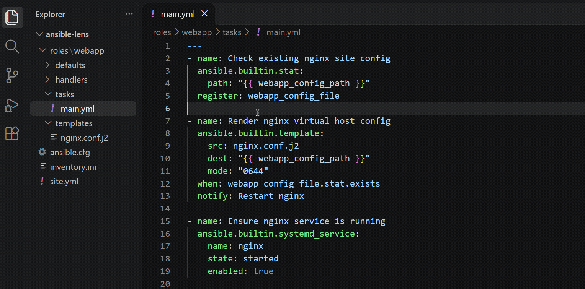

# Ansible Lens

[](https://marketplace.visualstudio.com/items?itemName=amr-io.ansible-lens)
[](https://scorecard.dev/viewer/?uri=github.com/amr-io/ansible-lens)
[](./LICENSE)

**Fast Ansible language server, IntelliSense, and <20ms linter for YAML & Jinja2 — zero Python, WSL, or Docker required.**

---

## Why Ansible Lens?

Editing Ansible playbooks shouldn't require installing Python virtual environments, WSL2, or Docker containers just to get hover docs, autocomplete, and linting. **Ansible Lens** is a pure TypeScript, zero-dependency Language Server & VS Code extension powered by pre-compiled static collection metadata packs. It works identically out of the box on **Windows, macOS, and Linux** in milliseconds.

---

## See It in Action

### Pylance-Style Hover & `Ctrl+Click` Module Docs


### `register:` Return-Value & `.j2` Template Autocomplete


### Instant (<20ms) Linting & 1-Click Quick-Fixes


---

## Key Features

- **Zero Python, WSL, or Docker:** Runs natively in pure Node.js/TypeScript on Windows, macOS, and Linux. Never spawns `ansible-playbook` or `ansible-lint` subprocesses while you type.
- **Instant (<20ms) Fault-Tolerant Linting:** Concrete Syntax Tree (CST) YAML + Jinja2 scanner with 24 clean-room MIT-licensed rules, 1-click Quick-Fixes (`Convert File to FQCN`, Levenshtein *"Did you mean?"*, `var-naming[no-role-prefix]`), and debounced incremental revalidation.
- **Pylance-Style Hover & `Ctrl+Click` Module Docs:** Rich Markdown hover cards with parameter tables, defaults, `choices`, and return schemas — plus configurable `Ctrl+Click` (`renderedPreview`, `openInBrowser`, or `disabled`) with zero permanent underlines.
- **`register:` Return-Value Type Inference (`loop:`-Aware):** Autocompletes registered fields (e.g. `webapp_version_file.stat.exists`, `.rc`, `.stdout`, and `.results[].*` when `loop:` is used) across tasks, multi-line `when:` lists, and `.j2` templates.
- **22-Level Cross-File Variable Intelligence & `.j2` Templates:** Tracks `defaults/`, `vars/`, `group_vars/`, `host_vars/`, relative `vars_files:` (with `missing-vars-file` validation & cache eviction), `include_vars:`, inventory, `set_fact:`, and `register:`, with scoped completion ranking (`0_` role-local → `1_` shared → `2_` other roles → `3_` magic vars) and smart `{{ | }}` auto-spacing.
- **Nested Monorepo `ansible.cfg` Discovery & Project Integrity:** Walks upward to locate `ansible.cfg` (`roles_path`, `inventory`), validates missing roles/handlers/templates/`vars_files`, and prefers same-role handlers on `notify:` Go-to-Definition.
- **Smart Hybrid Activation:** Activates on Ansible YAML & `*.j2` templates while ignoring Kubernetes manifests, Docker Compose, and GitHub Actions workflows — coexisting cleanly with `redhat.vscode-yaml`.
- **Bundled `ansible.builtin` + 90+ Silent Auto-Downloaded Collections:** Works offline out of the box and lazily downloads 90+ Ansible community collection packs (`ansible.posix`, `community.general`, `community.docker`, `amazon.aws`, `kubernetes.core`, etc.) with SHA-256 verification against `manifest.json`.

---

## Comparison: Ansible Lens vs. `redhat.ansible`

| Feature | **Ansible Lens** (`amr-io.ansible-lens`) | **Red Hat Ansible** (`redhat.ansible`) |
| :--- | :--- | :--- |
| **Native Windows support (no WSL/Docker)** | **Yes — 100% native** | Requires WSL or Execution Environment container |
| **Python / `ansible-core` / `ansible-lint` required** | **Zero** | Required for linting & full module docs |
| **Lint latency (300-line playbook)** | **~10.7 ms** (in-process) | ~2,622 ms (Python `ansible-lint` subprocess) |
| **Smart `redhat.vscode-yaml` coexistence** | **Yes** (auto-detects Ansible vs. K8s/GHA/Compose) | Requires changing language mode to `ansible` |
| **`register:` return-value autocomplete** | **Yes** (`loop:`-aware & nested `.stat.*`) | Limited |
| **22-level variable precedence hover** | **Yes** | No |
| **`.j2` template IntelliSense & `{{ \| }}` auto-space** | **Yes** | Limited |
| **License** | **MIT** (clean-room TypeScript) | GPL-3.0 (`ansible-lint` / `ansible-core`) |
| **Telemetry** | **Zero telemetry** | Optional Red Hat telemetry |

---

## Verified Benchmarks

Measured on GitHub Actions `ubuntu-latest` (4 vCPU AMD EPYC 9V45, 15.6 GB RAM, Node.js `v22.23.5`, `ansible-lint 26.11.0` / `ansible-core 2.21.6`) over 5 runs on the same 302-line (49-task) playbook via [`.github/workflows/benchmarks.yml`](./.github/workflows/benchmarks.yml) ([latest run](https://github.com/amr-io/ansible-lens/actions/runs/44958397058)):

| Tool | Runtime | Median | 5-Run Timings |
| :--- | :--- | ---: | :--- |
| **Ansible Lens** (in-process LSP) | Pure TypeScript / Node.js | **10.73 ms** | `9.11, 16.38, 10.73, 11.81, 6.47 ms` |
| **ansible-lint** (CLI) | Python | **2,622.4 ms** | `3090.0, 2606.4, 2862.1, 2576.5, 2622.4 ms` |

**Result:** **~244× faster** median analysis time with zero Python subprocess overhead.

---

## Quick Start

### VS Code Marketplace (Recommended)

Search **`Ansible Lens`** (`amr-io.ansible-lens`) in the VS Code Extensions view, or install from the command line:

```bash
code --install-extension amr-io.ansible-lens
```

Open any Ansible playbook, role, or `.j2` template — Ansible Lens activates automatically with zero configuration.

### Offline / Verifiable `.vsix` Install

1. Download the latest `ansible-lens-<version>.vsix`, `sbom.cdx.json`, and `SHA256SUMS.txt` from [GitHub Releases](https://github.com/amr-io/ansible-lens/releases).
2. Verify the checksum (`sha256sum -c SHA256SUMS.txt`) and SLSA build provenance (`gh attestation verify ansible-lens-<version>.vsix --repo amr-io/ansible-lens`).
3. Install in VS Code:
   ```bash
   code --install-extension ansible-lens-<version>.vsix
   ```

---

## Documentation

- **[Lint & Project Integrity Rules (`docs/rules.md`)](./docs/rules.md)** — All 24 clean-room rules, profiles, Bad vs. Good examples, and Quick-Fixes.
- **[Configuration Reference (`docs/configuration.md`)](./docs/configuration.md)** — Every `ansibleLens.*` setting (`lint.*`, `metadata.*`, `jinja.autoSpaceBraces`, `ansible.rootPaths`, `docs.ctrlClickBehavior`) and command.
- **[Troubleshooting Guide (`docs/troubleshooting.md`)](./docs/troubleshooting.md)** — Windows & nested monorepos, `redhat.vscode-yaml` coexistence, and air-gapped `manifestUrl` mirror setup.
- **[Architecture (`ARCHITECTURE.md`)](./ARCHITECTURE.md)** & **[ADRs (`docs/adr/`)](./docs/adr/)** — Design decisions and monorepo structure.

---

## Privacy & Supply-Chain Security

- **Zero Telemetry:** Ansible Lens collects zero analytics, zero crash reports, and makes no outbound network requests other than optional SHA-256-verified collection metadata pack downloads (configurable or disableable via `ansibleLens.metadata.autoDownload`).
- **Verifiable Releases:** Every GitHub Release ships with a CycloneDX SBOM (`sbom.cdx.json`), `SHA256SUMS.txt`, and GitHub SLSA Build Provenance attestation.

---

## License

Licensed under the [MIT License](./LICENSE). See [CONTRIBUTING.md](./CONTRIBUTING.md), [SECURITY.md](./SECURITY.md), and [THIRD_PARTY_NOTICES.md](./THIRD_PARTY_NOTICES.md).

---

<sub>_Ansible Lens is an independent, community-built extension and is not affiliated with or endorsed by Red Hat, Inc. Ansible® is a registered trademark of Red Hat, Inc._</sub>
