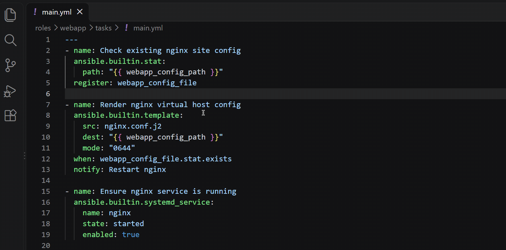
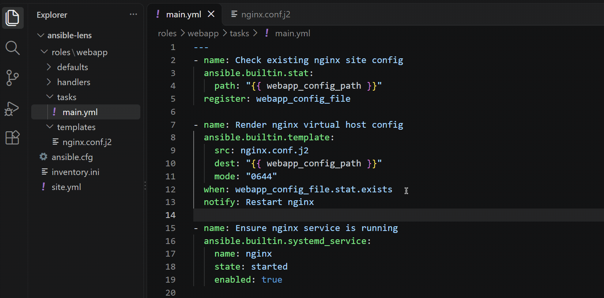
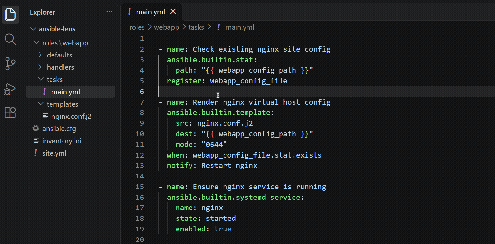

# Ansible Lens

[](https://marketplace.visualstudio.com/items?itemName=amr-io.ansible-lens)
[](https://scorecard.dev/viewer/?uri=github.com/amr-io/ansible-lens)
[](./LICENSE)

**Fast Ansible language server, IntelliSense, and <20ms linter for YAML & Jinja2 — zero Python, WSL, or Docker required.**

## Why Ansible Lens?

**Ansible Lens** is a pure TypeScript, zero-dependency Ansible Language Server & linter powered by static collection metadata packs. It runs natively on **Windows, macOS, and Linux** with zero Python, zero WSL, and zero Docker.

## See It in Action

### Pylance-Style Hover & `Ctrl+Click` Module Docs


### `register:` Return-Value & `.j2` Template Autocomplete


### Instant (<20ms) Linting & 1-Click Quick-Fixes


## Key Features

- **Sub-20ms Fault-Tolerant Linting:** 24 clean-room MIT-licensed rules with 1-click Quick-Fixes (`Convert File to FQCN`, Levenshtein *"Did you mean?"*, `var-naming[no-role-prefix]`) and debounced incremental revalidation.
- **Pylance-Style Hover & `Ctrl+Click` Docs:** Rich Markdown hover cards with parameter tables, defaults, `choices`, and return schemas, plus configurable `Ctrl+Click` (`renderedPreview`, `openInBrowser`, `disabled`) with zero permanent underlines.
- **`register:` Return-Value Inference (`loop:`-Aware):** Autocompletes registered fields (`.stat.*`, `.rc`, `.stdout`, `.results[].*`) across tasks, multi-line `when:` lists, and `.j2` templates.
- **22-Level Cross-File Variable Intelligence & `.j2` Templates:** Tracks `defaults/`, `vars/`, `group_vars/`, `host_vars/`, relative `vars_files:` (with `missing-vars-file` validation & cache eviction), `include_vars:`, inventory, `set_fact:`, and `register:`, with scoped completion ranking and smart `{{ | }}` auto-spacing.
- **Smart Hybrid Activation:** Coexists cleanly with `redhat.vscode-yaml` while ignoring Kubernetes, Docker Compose, and GitHub Actions YAML.
- **Bundled `ansible.builtin` + 90+ Silent Auto-Downloaded Collections:** Works offline out of the box and lazily fetches 90+ collection packs with SHA-256 verification.

## Comparison vs. `redhat.ansible`

| Feature | **Ansible Lens** | **Red Hat Ansible** |
| :--- | :--- | :--- |
| **Native Windows (no WSL/Docker)** | **Yes** | Requires WSL or EE container |
| **Python / `ansible-lint` required** | **Zero** | Required |
| **Lint latency (300-line playbook)** | **~10.7 ms** | ~2,622 ms |
| **`register:` return-value autocomplete** | **Yes** (`loop:`-aware) | Limited |
| **22-level variable precedence hover** | **Yes** | No |
| **License** | **MIT** | GPL-3.0 |

## Verified Benchmarks

Measured on GitHub Actions `ubuntu-latest` (4 vCPU AMD EPYC 9V45, Node.js `v22.23.5`, `ansible-lint 26.11.0`) over 5 runs on the same 302-line playbook ([benchmark workflow](https://github.com/amr-io/ansible-lens/blob/main/.github/workflows/benchmarks.yml)):

| Tool | Runtime | Median |
| :--- | :--- | ---: |
| **Ansible Lens** (in-process LSP) | Pure TypeScript / Node.js | **10.73 ms** |
| **ansible-lint** (CLI) | Python | **2,622.4 ms** |

## Install

Search **`Ansible Lens`** (`amr-io.ansible-lens`) in the VS Code Extensions view, or run:

```bash
code --install-extension amr-io.ansible-lens
```

For offline or SLSA-verified `.vsix` installs, download the release artifacts from [GitHub Releases](https://github.com/amr-io/ansible-lens/releases).

## Documentation

- [Lint & Project Integrity Rules](https://github.com/amr-io/ansible-lens/blob/main/docs/rules.md)
- [Configuration Reference](https://github.com/amr-io/ansible-lens/blob/main/docs/configuration.md)
- [Troubleshooting Guide](https://github.com/amr-io/ansible-lens/blob/main/docs/troubleshooting.md)

## Privacy

**Zero Telemetry:** Ansible Lens collects zero analytics or crash reports and makes no outbound requests other than optional SHA-256-verified collection metadata pack downloads.

## License

MIT License. See [LICENSE](./LICENSE).

---

<sub>_Ansible Lens is an independent, community-built extension and is not affiliated with or endorsed by Red Hat, Inc. Ansible® is a registered trademark of Red Hat, Inc._</sub>
